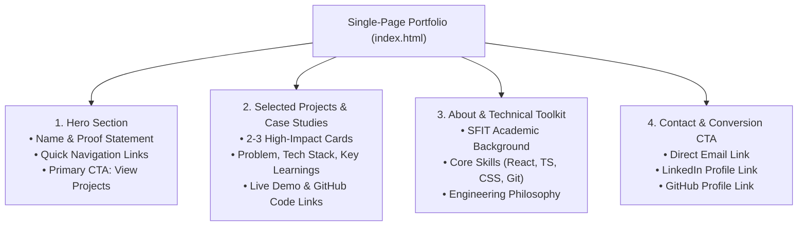

# Student Software Engineering Portfolio Sitemap & Strategy

**Author**: Nalin Tuscano  
**Education**: B.Tech Information Technology, St. Francis Institute of Technology (SFIT), Mumbai  
**Internship Track**: FlyRank AI Internship — Frontend AI Engineering Track  
**Date**: October 2026  

---

## 1. Portfolio Strategy Overview

### Target Audience
- **Primary Audience**: Technical Recruiters, Frontend Hiring Managers, and Engineering Mentors reviewing candidates for frontend engineering internships and entry-level developer roles.
- **What They Look For**:
  - Genuine mastery of foundational web technologies: HTML, CSS, JavaScript, React, and TypeScript.
  - Ability to write clean, modular, and accessible code with structured Git practices.
  - Honest presentation of student projects without inflated metrics, false senior claims, or buzzword bloat.
  - Clear technical communication and ability to explain architectural trade-offs.

### Primary Visitor Action (Conversion Goal)
- **Primary Goal**: The visitor reviews one featured project (inspecting the live demo and GitHub repository code) and clicks the primary call to action: **"Connect on LinkedIn"** or **"Send an Email"** to initiate an interview or technical conversation.

---

## 2. Proof Statement Definition

### Candidate Statements Evaluated

| Option | Statement | Evaluation |
| :--- | :--- | :--- |
| **Option A (Recommended)** | *"I am an IT student and frontend engineer who builds clean, accessible, and type-safe web interfaces using React, TypeScript, and disciplined AI-assisted development workflows."* | **Defensible & Authentic**: Specifically focuses on demonstrable skills (TypeScript type safety, React component architecture, accessibility, disciplined AI tool usage) without overpromising unverified senior experience. |
| **Option B (Alternative)** | *"I am an engineering student developing production-grade full-stack web applications and scalable digital solutions with advanced AI coding tools."* | **Risky & Overbroad**: Overpromises full-stack production scalability, invites skepticism regarding backend/cloud operations, and is harder to defend with student coursework evidence. |

### Selected Proof Statement
> **"I am an IT student and frontend engineer who builds clean, accessible, and type-safe web interfaces using React, TypeScript, and disciplined AI-assisted development workflows."**

---

## 3. Visitor Journey (Landing to Primary Action)

The visitor moves through a focused 5-stage conversion pathway:

```
[1. Landing / Hero] ➔ [2. Scan Proof & Role] ➔ [3. Inspect Featured Project] ➔ [4. Review Skills & Background] ➔ [5. Click Primary CTA (Connect)]
```

1. **Stage 1: Arrival & Value Proposition (0–5 seconds)**  
   The visitor lands on the page. The Hero section immediately conveys who Nalin is, displays the core proof statement, and provides immediate visual anchors to view projects or download a resume.
2. **Stage 2: Fast Evidence Scanning (5–20 seconds)**  
   The visitor scrolls to **Selected Projects**. Instead of ten random homework assignments, they see 2–3 structured project cards showcasing tangible React and TypeScript implementations.
3. **Stage 3: Deep Technical Inspection (20–60 seconds)**  
   The visitor clicks into one case study card, inspects the live deployed application, and reviews the GitHub repository to evaluate commit hygiene, README clarity, and TypeScript interfaces.
4. **Stage 4: Credibility & Context Validation (60–90 seconds)**  
   The visitor skims the **About & Toolkit** section to confirm formal academic background (SFIT B.Tech IT), verified tools (HTML, CSS, JS, React, TS, Git), and ongoing engineering learning.
5. **Stage 5: Conversion Action (90–120 seconds)**  
   Having validated genuine competence, the visitor reaches the **Contact** section and clicks the primary CTA: sending an email or connecting via LinkedIn for an internship discussion.

---

## 4. Visual Sitemap Architecture

A focused single-page architecture is selected to minimize bounce rate and maintain high conversion focus.



### Text-Based Sitemap Hierarchy
```text
Portfolio Root (Single Page: /)
│
├── 1. Hero Section
│   ├── Headline: Nalin Tuscano — Frontend AI Engineering Intern & IT Student
│   ├── Proof Statement (Clear value claim)
│   ├── Secondary Links: Resume (PDF), GitHub, LinkedIn
│   └── Primary Action Anchor: "Explore Selected Projects"
│
├── 2. Selected Projects / Case Studies
│   ├── Project 1: FlyRank Capstone Application [Placeholder: React + TS + Vite]
│   │   ├── Problem statement, architecture, type-safe implementation
│   │   └── Direct links: Live Demo | GitHub Repository
│   ├── Project 2: FlyRank FE-01 Repository & AI Toolchain Setup [Verified]
│   │   ├── Disciplined Git workflow, GEMINI.md instructions, clean config
│   │   └── Direct link: GitHub Repository
│   └── Project 3: Academic IT Coursework Project [Verified Coursework Base]
│       └── Problem solved, technologies used, GitHub repository link
│
├── 3. About & Technical Toolkit
│   ├── Academic Background: B.Tech Information Technology at SFIT, Mumbai
│   ├── Verified Toolkit: React, TypeScript, Vite, Modern CSS, Git, Python, SQL
│   └── Engineering Approach: Clean code, accessibility, disciplined AI usage
│
└── 4. Contact & Footer
    ├── Primary CTA Heading: "Let's Connect for Internship & Engineering Roles"
    ├── Contact Channels: Email (mailto link), LinkedIn profile, GitHub
    └── Copyright: © 2026 Nalin Tuscano
```

---

## 5. Section Purpose & Essential Content

| Section | Strategic Purpose | Essential Content Included | Excluded Distractions |
| :--- | :--- | :--- | :--- |
| **Hero** | Capture attention within 5 seconds and establish core identity. | Name, current role (SFIT IT student, FlyRank intern), proof statement, 1-click resume download, and quick anchor to projects. | No complex carousel sliders, distracting generic animations, or vague buzzword taglines. |
| **Selected Projects** | Provide tangible, verifiable proof supporting the proof statement. | 2–3 curated projects with problem summary, tech stack badges (React, TypeScript), live demo link, and public GitHub code link. | No uncompleted tutorials, half-baked clones, or unverified commercial claims. |
| **About & Skills** | Establish academic grounding and technical toolkit credibility. | Degree details at SFIT, verified languages and frameworks, and disciplined engineering habits. | No arbitrary animated percentage skill bars (e.g., "90% JavaScript") or long life stories. |
| **Contact** | Facilitate immediate, low-friction visitor outreach. | Direct email address, LinkedIn profile, GitHub profile, and a friendly closing invitation. | No bulky multi-field contact forms requiring backend services that fail or drop leads. |

---

## 6. Rationale for Excluding Unnecessary Pages

To protect conversion rate and clarity, the following common portfolio pages are deliberately excluded:

1. **No Separate Multi-Page Blog**:
   - *Why*: Maintaining a dedicated blog requires frequent publishing. A blog with one or zero recent posts creates a negative impression. Technical writing is better published directly on LinkedIn or in repository `README.md` files.
2. **No Dedicated "Services" Page**:
   - *Why*: As an undergraduate student seeking internships or junior frontend roles, offering freelance "agency services" confuses recruiters who are evaluating team fit and engineering fundamentals.
3. **No Separate Multi-Page Resume**:
   - *Why*: Recruiters and hiring managers spend an average of 10–30 seconds reviewing a portfolio. Embedding a 1-click downloadable PDF resume link directly in the Hero and About sections is vastly faster than forcing them to navigate a separate page.
4. **No Cluttered "All Projects" Archive**:
   - *Why*: Showing 15 small classroom exercises dilutes quality. Curating 2–3 polished, well-documented projects demonstrates maturity and editorial judgment.

---

## 7. Project Evidence: Verified Work vs. In-Progress Placeholders

To maintain strict academic and professional honesty, projects are categorized clearly:

### Verified & Demonstrable Work
- **FlyRank FE-01: Environment & AI Toolchain Setup**:
  - *Status*: Verified.
  - *Proof*: GitHub repository (`Fly-Rank-AI-week-1`) featuring structured Conventional Commits, standard `.gitignore`, MIT License, `GEMINI.md` AI guidelines, and clean documentation.
- **Academic Coursework Projects (SFIT IT)**:
  - *Status*: Verified academic coursework.
  - *Proof*: Coursework repositories demonstrating fundamentals in C++, Python, SQL/DBMS, and base web technologies.

### In-Progress Project Placeholders
- **FlyRank Frontend Capstone Project**:
  - *Status*: In progress (concept formulation phase).
  - *Placeholder Claim*: Interactive frontend web application built using React, TypeScript, Vite, and modern CSS. Detailed problem statement and live link will be added upon milestone completion.
- **Accessible UI Component Showcase**:
  - *Status*: Planned placeholder.
  - *Placeholder Claim*: Modular React/TypeScript UI component library demonstrating WCAG 2.1 AA accessibility and responsive design tokens.

---

## 8. AI Toolkit Verification Checklist

To complete the AI fluency setup, verify access to the free tiers of each tool.

> **Privacy Notice**: You must sign in or create accounts personally. Never enter passwords, tokens, or private credentials into project files.

- [ ] **Claude (Anthropic)**:
  - URL: [claude.ai](https://claude.ai)
  - Status: Verify free account access and ability to open chat conversations.
- [ ] **ChatGPT (OpenAI)**:
  - URL: [chatgpt.com](https://chatgpt.com)
  - Status: Verify free account access and test standard prompt input.
- [ ] **Gemini (Google)**:
  - URL: [gemini.google.com](https://gemini.google.com)
  - Status: Verify access using your personal Google account.
- [ ] **Perplexity AI**:
  - URL: [perplexity.ai](https://perplexity.ai)
  - Status: Verify free search and citation capability on [perplexity.ai](https://perplexity.ai).

---

## 9. Final Assignment Submission Checklist

- [x] **Portfolio Strategy Document Prepared**: `PORTFOLIO_SITEMAP.md` created with audience, proof statement, visitor journey, and sitemap.
- [x] **Claude Project Instructions Prepared**: `PORTFOLIO_CLAUDE_PROJECT_INSTRUCTIONS.md` created with custom tutor guidelines.
- [x] **Pressure-Test Prompt Prepared**: `PORTFOLIO_SITEMAP_TEST_PROMPT.md` prepared with comprehensive evaluation criteria.
- [ ] **Manual Step: Claude Project Setup**:
  - Open Claude &rarr; Projects &rarr; Create Project named `FlyRank Portfolio Strategy`.
  - Copy instructions from `PORTFOLIO_CLAUDE_PROJECT_INSTRUCTIONS.md` into Custom Instructions.
- [ ] **Manual Step: Toolkit Verification**:
  - Confirm free tier logins for Claude, ChatGPT, Gemini, and Perplexity.
- [ ] **Manual Step: Execute Test Prompt**:
  - Paste the prompt from `PORTFOLIO_SITEMAP_TEST_PROMPT.md` into the Claude Project conversation.
  - Review Claude's critique and recommendations.
- [ ] **Manual Step: Capture Screenshots**:
  - Screenshot 1: Configured Claude Project settings with title and instructions.
  - Screenshot 2: Actual conversation showing the test prompt and Claude's output.
- [ ] **Manual Step: FlyRank Portal Submission**:
  - Upload `PORTFOLIO_SITEMAP.md` and both screenshot files to the FlyRank assignment portal.
